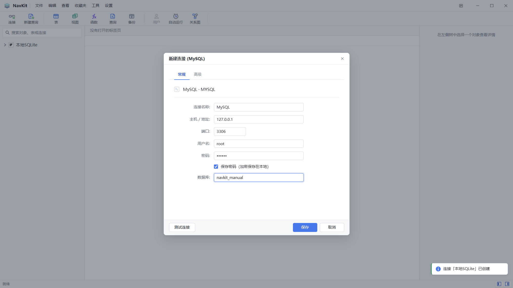
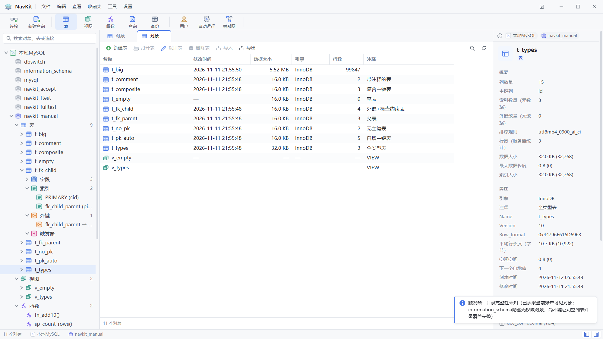
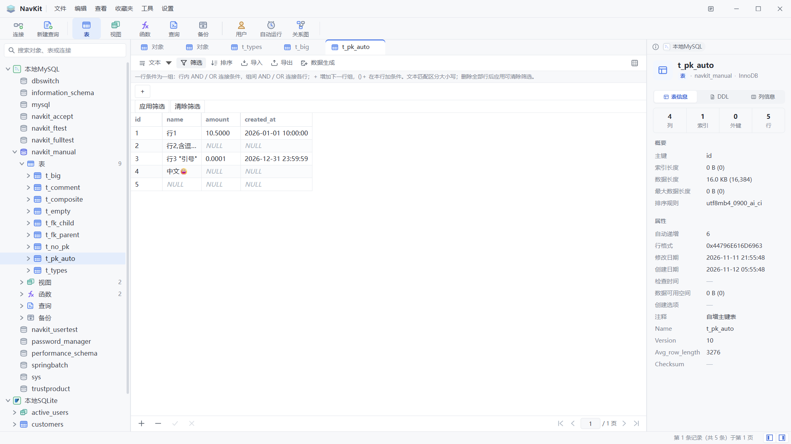
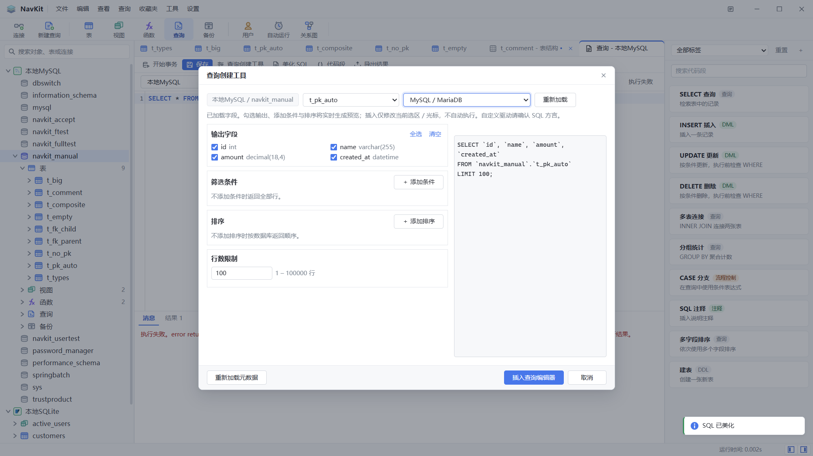
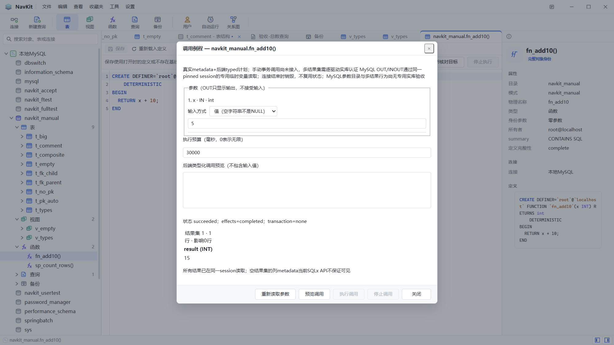
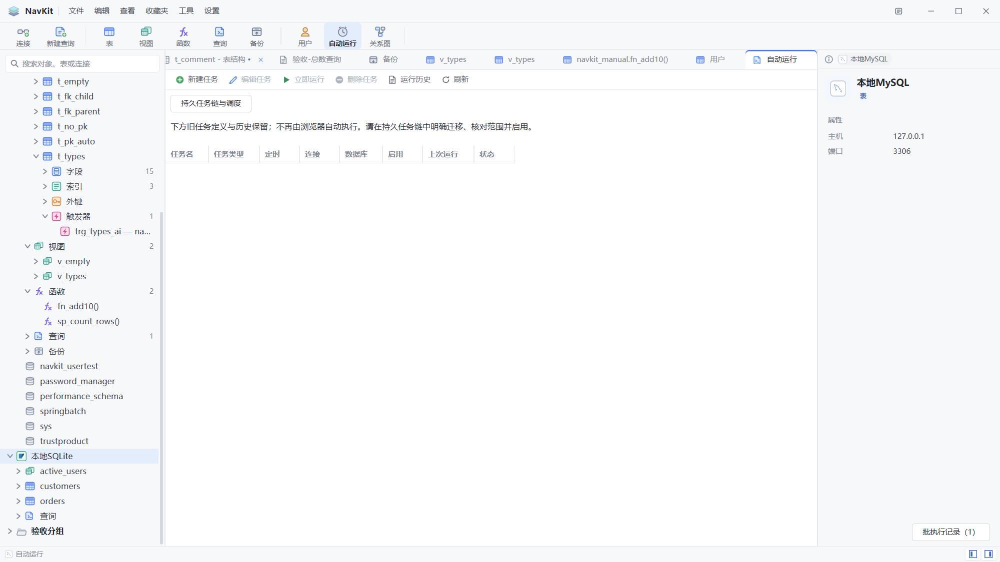
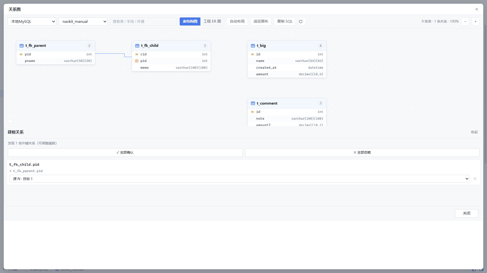
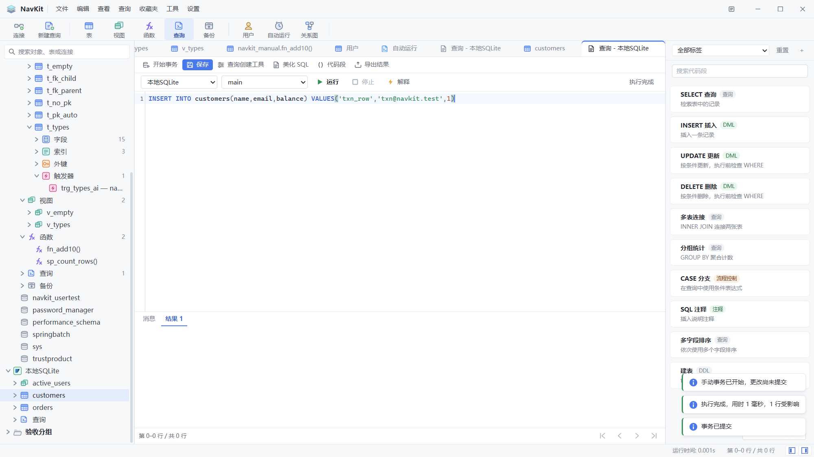

# NavKit 全功能桌面验收报告 · 用户手册（2026-11-12）

> **一句话结论：79 项功能用例全部通过（真实桌面 + 真实数据库 + 逐步截图），过程中发现并修复 2 个真实产品缺陷，界面风格检查无修改项。**
>
> - 测试对象：NavKit 工作树代码（debug exe + 当前前端源码，`tauri.conf.json` devUrl 形态）
> - 测试方式：WebView2 CDP 驱动真实桌面窗口；**每个功能同时走真实 GUI 点击与 Tauri IPC 通道**（`window.__TAURI_INTERNALS__.invoke` / `src/core/api.ts`），关键数据变化用独立数据库连接复核
> - 证据目录：[`docs/active/evidence/manual-20261112/`](evidence/manual-20261112/)（186 张逐步截图 + report.json + 运行日志）
> - 运行器与用例：`tools/acceptance/e2e/manual-runner-20261112.mjs` + `manual-tests-20261112.mjs`（可重复执行）

---

## 一、测试环境与夹具

| 项 | 内容 |
|---|---|
| 被测程序 | `src-tauri/target/debug/navkit.exe`（本工作树构建）+ Vite dev 前端（`npm run dev` :5183） |
| 数据库 1 | MySQL 8.0.44（本机 127.0.0.1:3306，root），夹具库 `navkit_manual` 由 `testdata/mysql_fixture.sql` 构建：9 张表（含全类型表、复合主键、外键+检查约束、10 万行大表）+ 2 视图 + 1 存储过程 + 1 函数 + 1 触发器 + 4 索引 |
| 数据库 2 | SQLite（`testdata/demo.db` 副本：customers 25 行 / orders 50 行 / 视图 active_users），随用例自由读写 |
| 运行隔离 | 临时运行时目录（配置/备份/导出产物全部写入临时目录，不污染工作区 `data/`），结束后自动清理 |
| 截图方式 | Playwright `page.screenshot`（1600×900 主窗口），每用例 1–6 张，含操作前/后对比帧 |

## 二、总体结果

| 轮次 | 步骤 | 通过 | 失败 | 说明 |
|---|---|---|---|---|
| 第 3 轮（脚本初版） | 78 | 51 | 27 | 夹具/选择器问题为主 |
| 第 5 轮 | 79 | 69 | 10 | 向导类交互暴露 |
| 第 6 轮 | 79 | 73 | 7 | 发现产品 bug #1 |
| 第 8 轮 | 79 | 78 | 1 | 发现产品 bug #2 |
| **第 9 轮（最终）** | **79** | **79** | **0** | **全部通过，控制台 0 报错** |

修复后回归：`cargo test --lib batch_execution` 21/21 ✅、`cargo test --lib table_workflows` 32/32 ✅、`npm run test:ui` **1105 通过 / 0 失败**（1 项按条件跳过）。

### 本轮发现并修复的产品缺陷（2 个，均有修改前后截图）

| # | 问题 | 根因 | 修复 | 修改前 → 修改后 |
|---|---|---|---|---|
| 1 | **MySQL 表设计器无法读取字段元数据**：打开任意表的结构页显示 `IpcError 1064` SQL 语法错误，字段数为 0，无法设计表 | 元数据查询 `GENERATION_EXPRESSION AS generated` —— `generated` 是 MySQL 保留字，别名未加反引号（同语句的 `default` 已正确加引号） | [`src-tauri/src/table_workflows_native_metadata.rs:20`](../../src-tauri/src/table_workflows_native_metadata.rs) 别名改为 `` AS `generated` `` | [修改前](evidence/manual-20261112/bugfix/BUG1-table-designer-before.png) → [修改后](evidence/manual-20261112/073-S05-OPEN-fields.png) |
| 2 | **MySQL 数据生成写入与批量任务全部失败**：向导走完后报「结果未知 0/5 条语句 · 任务结束回执失败」，0 行写入 | `SELECT CONNECTION_ID()` 返回 `BIGINT UNSIGNED`，批任务用 `i64` 解码 —— sqlx 类型不匹配，在发出任何 SQL 之前就失败（8ms）；代码中其它 4 处同查询均用 `u64`，仅批量模块用错 | [`src-tauri/src/batch_execution.rs:219`](../../src-tauri/src/batch_execution.rs) `i64` → `u64` | [修改前](evidence/manual-20261112-round8-backup/126-S09-DATAGEN-written.png) → [修改后](evidence/manual-20261112/127-S09-DATAGEN-rows.png) |

> 两个缺陷的定位过程：bug #2 通过临时诊断输出 + MySQL general log（连接建立后无任何 SQL 到达服务器）+ 原始 IPC 快照三重证据锁定；修复后探针验证「已扫描 5，执行回执 5，错误 0，影响行 5，事务 committed」。

---

## 三、功能逐项演示（用户手册视角）

以下按模块给出操作路径、验证点与现场截图。截图文件均在 [`evidence/manual-20261112/`](evidence/manual-20261112/)。

### 3.1 主界面与窗口

| 功能 | 操作 | 验证点 | 截图 |
|---|---|---|---|
| 主界面 | 启动即见 | 标题栏+菜单栏+命令条+连接树+信息面板+状态栏完整 | [001](evidence/manual-20261112/001-S00-BOOT.png) |
| 最大化/还原 | 标题栏 ⬜ | 窗口状态真实切换 | [002](evidence/manual-20261112/002-S00-WIN-MAX-after.png) |
| 最小化/恢复 | 标题栏 — | isMinimized 真实状态轮询确认 | [004](evidence/manual-20261112/003-S00-WIN-MIN-restored.png) |
| 专注模式 | F11 | 进入/退出全屏 | [016](evidence/manual-20261112/016-S01-FOCUS-on.png) / [017](evidence/manual-20261112/017-S01-FOCUS-off.png) |

主界面全景：


### 3.2 菜单栏（文件/编辑/查看/收藏夹/工具/查询 + 设置）

逐个打开每个顶级菜单并截图，全部菜单项有内容、可悬停、可执行；「文件→新建」子菜单正常展开（连接/查询/组）；「查看」菜单四个开关（侧边栏/信息面板/状态栏/工具栏）逐一切换并恢复；「设置」为菜单栏尾部直连项，点击直接打开设置对话框。

- 菜单遍历：[005](evidence/manual-20261112/004-S01-MENU-文件.png) [006](evidence/manual-20261112/005-S01-MENU-编辑.png) [007](evidence/manual-20261112/006-S01-MENU-查看.png) [008](evidence/manual-20261112/007-S01-MENU-收藏夹.png) [009](evidence/manual-20261112/008-S01-MENU-工具.png)
- 新建子菜单：[011](evidence/manual-20261112/010-S01-FILE-NEW-SUB.png)
- 面板开关恢复后：[015](evidence/manual-20261112/015-S01-VIEW-TOGGLES-restored.png)

### 3.3 连接管理（新建/测试/分组/编辑/属性/复制）

| 功能 | 操作 | 验证点 | 截图 |
|---|---|---|---|
| 数据源 Picker | 命令条「连接」 | 101 种数据源卡片 + 搜索收敛 + 列表视图 | [018](evidence/manual-20261112/018-S02-PICKER-cards.png) |
| 新建 SQLite 连接 | Picker→SQLite→填文件路径 | 常规/高级页、测试连接「连接成功 — 3.46.0」、保存后树中出现节点 | [020–023](evidence/manual-20261112/020-S02-NEW-SQLITE-general.png) |
| 新建 MySQL 连接 | Picker→MySQL→主机/端口/用户/密码/库 | 真实认证测试成功、保存 | [024–026](evidence/manual-20261112/025-S02-NEW-MYSQL-filled.png) |
| 错误密码（负例） | 测试连接 | 明确报错，不冒充成功 | [028](evidence/manual-20261112/028-S02-BAD-PASSWORD.png) |
| 分组 | 空白区右键→新建组；Ctrl+X/V 移入 | 连接入库、组重命名生效（IPC 复核） | [029–031](evidence/manual-20261112/029-S02-GROUP-created.png) |
| 编辑连接 | 右键→编辑连接 | 密码留空保存后密文不变（不回显明文） | [032](evidence/manual-20261112/033-S02-EDIT-CONN.png) |
| 服务器信息 | 右键→服务器信息 | 版本/字符集/连接信息 | [033](evidence/manual-20261112/034-S02-CONN-PROPS.png) |
| 复制连接 | 右键→复制连接 | 对话框打开、可取消 | [034](evidence/manual-20261112/035-S02-DUPLICATE-CONN.png) |

新建 MySQL 连接与测试成功现场：



### 3.4 数据库浏览（连接树/信息面板）

双击打开连接（真实认证）→ 双击打开数据库 → 表/视图/函数/查询/备份 五个分组展开；表节点再展开 字段/索引/外键/触发器；点击节点右侧信息面板显示详情（连接→库→表→视图→函数）；右键刷新与 F5 生效；新建/删除数据库对话框可打开可取消。

- 打开连接与库：[035](evidence/manual-20261112/036-S03-OPEN-CONN-mysql.png) [036](evidence/manual-20261112/037-S03-OPEN-CONN-sqlite.png) [037](evidence/manual-20261112/039-S03-OPEN-DB-groups.png)
- 表节点深层分组：[039](evidence/manual-20261112/041-S03-TABLE-NODES-groups.png)
- 信息面板（表）：[041](evidence/manual-20261112/043-S03-INFO-table.png)

信息面板表详情（含修复后新增的 amount2 字段、触发器 trg_types_ai）：



### 3.5 表数据网格（浏览/筛选/排序/编辑/分页）

| 功能 | 操作 | 验证点 | 截图 |
|---|---|---|---|
| 打开全类型表 | 双击 t_types | 中文/emoji/引号/二进制列正确显示 | [046](evidence/manual-20261112/047-S04-OPEN-TABLE.png) |
| 10 万行分页 | 打开 t_big → 下一页/页码跳转 | 页码切换、总数正确 | [047–049](evidence/manual-20261112/048-S04-PAGINATION-page2.png) |
| 筛选 | 工具栏「筛选」→ 字段下拉 + 运算符 + 值内联输入 | AND 零结果不禁用、OR 两行、清除恢复；行/条件组连接可切换 | [051–054](evidence/manual-20261112/051-S04-FILTER-panel.png) |
| 排序 | 「排序」→ 两字段 + ASC/DESC + 上移 | 顺序真实反映在 SQL 与网格 | [055–058](evidence/manual-20261112/056-S04-SORT-panel.png) |
| 编辑单元格 | 双击单元格 → 改值 → 提交改动 | UPDATE 真实生效（行数不变） | [059–060](evidence/manual-20261112/060-S04-EDIT-CELL-before.png) |
| 插入/删除行 | 底部 ＋ / − / ✓ | 草稿行 → 提交持久 → 删除提交归零 | [061–064](evidence/manual-20261112/062-S04-INSERT-ROW-before.png) |
| 复制 | 网格右键菜单 | 复制单元格/行/含表头菜单齐全 | [065](evidence/manual-20261112/066-S04-GRID-COPY-menu.png) |
| 列操作 | 列宽拖拽、列头右键、选择显示字段 | col-resize 光标、菜单正常 | [066–068](evidence/manual-20261112/068-S04-COLUMN-MENU-resized.png) |
| 跳过 Null | 查看→跳过 Null | 显示切换 | [069–070](evidence/manual-20261112/071-S04-NULL-on.png) |

筛选面板（一行条件组 + 行内 AND/OR + 内联值输入）：



### 3.6 表设计器（含 bug #1 修复验证）

打开 设计表 → 字段/索引/外键/检查/触发器 五个页签全部渲染；「添加字段」→ 填名称/类型/长度/小数位 → 保存（确认对话框）→ **真实库生效**（`getTableSchema` 复核新字段存在）；未保存关闭出现放弃确认（LeaveGuard）。

- 字段页签（修复后正常加载）：[073](evidence/manual-20261112/073-S05-OPEN-fields.png)
- 五页签：[074–077](evidence/manual-20261112/074-S05-OPEN-索引.png)
- 添加字段前后：[078](evidence/manual-20261112/078-S05-ADD-COLUMN-before.png) → [079](evidence/manual-20261112/079-S05-ADD-COLUMN-edited.png) → 确认 [080](evidence/manual-20261112/080-S05-ADD-COLUMN-confirm.png) → 真库生效 [081](evidence/manual-20261112/081-S05-ADD-COLUMN-after.png)

> 长度校验说明：长度必须为非负整数，DECIMAL 的小数位数填「小数位」列 —— 产品校验提示明确（「复杂类型参数请直接填写在类型中」），属正确防呆而非缺陷。

### 3.7 查询（编辑器/执行/补全/收藏/代码段/导出结果）

| 功能 | 操作 | 验证点 | 截图 |
|---|---|---|---|
| 查询页 | 选中库 → 命令条「新建查询」 | schema 跟随选中库 | [083](evidence/manual-20261112/083-S06-NEW-QUERY.png) |
| 运行 SELECT | 运行按钮 | 结果网格、中文/特殊字符正确 | [084](evidence/manual-20261112/084-S06-RUN-result.png) |
| 多语句 | `SELECT 1; SELECT 2; SELECT 3;` | 多结果页签 | [085](evidence/manual-20261112/085-S06-MULTI-tabs.png) |
| 快捷键 | Ctrl+Enter / F5 / Ctrl+Shift+Enter | 三种执行方式结果一致 | [086](evidence/manual-20261112/086-S06-KEYBOARD.png) |
| 错误 SQL（负例） | 查询不存在的表 | 错误信息清晰、不崩溃 | [087](evidence/manual-20261112/087-S06-ERROR.png) |
| 解释 EXPLAIN | 查询菜单→解释已选择的 | 执行计划行返回 | [088](evidence/manual-20261112/088-S06-EXPLAIN.png) |
| 美化 SQL | 查询菜单→美化 SQL（F6） | 格式化换行/关键字 | [089](evidence/manual-20261112/089-S06-BEAUTIFY-after.png) |
| SQL 补全 | 输入 `t_` + Ctrl+Space | 弹出真实表/字段提示 | [090](evidence/manual-20261112/090-S06-COMPLETION.png) |
| 查询创建工具 | 工具栏→查询创建工具 | 选表/字段 → 右侧实时 SELECT 预览 → 插入查询编辑器 | [091–093](evidence/manual-20261112/091-S06-QUERY-BUILDER-dialog.png) |
| 代码段 | 右侧面板 | 标签过滤、搜索收敛、点击插入不执行 | [094–095](evidence/manual-20261112/095-S06-SNIPPET-tag.png) |
| 收藏查询 | 工具栏「保存」→命名 | 收藏保存成功、可从收藏夹菜单打开并运行 | [097–099](evidence/manual-20261112/097-S06-SAVE-FAV-dialog.png) |
| 导出结果 | 工具栏「导出结果」 | ①格式 ②保存位置 两步向导 → CSV 真实生成 | [100–103](evidence/manual-20261112/102-S06-EXPORT-RESULT-step1-format.png) |
| 标签右键 | 标签右键 | 刷新/复制/关闭其他等菜单 | [105](evidence/manual-20261112/107-S06-TAB-CONTEXT-menu.png) |

查询创建工具（字段勾选 + 实时预览）：



### 3.8 备份 / 还原 / SQL 文件

| 功能 | 操作 | 验证点 | 截图 |
|---|---|---|---|
| 备份页签 | 命令条「备份」 | 列表 + 工具栏 | [109](evidence/manual-20261112/109-S07-BACKUP-TAB.png) |
| 创建备份 | IPC `create_backup` | .sql 文件真实落盘、列表 +1 | [110](evidence/manual-20261112/110-S07-BACKUP-CREATE-listed.png) |
| 备份详情 | 树→备份节点 | 信息面板显示大小/时间/注释 | [111](evidence/manual-20261112/111-S07-BACKUP-INFO-tree-empty.png) |
| 还原备份 | 污染数据 → `restore_backup` | 还原后污染行消失（数据回滚验证） | [112](evidence/manual-20261112/112-S07-BACKUP-RESTORE-restored.png) |
| 整库转储 | `dump_database_to_file` | 结构+数据齐全（CREATE/INSERT） | [113](evidence/manual-20261112/113-S07-DUMP-SQL-done.png) |
| 运行 SQL 文件 | `run_sql_file` | 逐条执行报告 total/succeeded/failed | [115](evidence/manual-20261112/114-S07-RUN-SQL-FILE.png) |

### 3.9 视图 / 函数 / 触发器

- 打开视图数据：[116](evidence/manual-20261112/115-S08-OPEN-VIEW-data.png)；设计视图对话框可打开取消
- 函数源码页（fn_add10，可编辑 + 重新核对目标）：[118](evidence/manual-20261112/116-S08-ROUTINE-OPEN.png)
- **调用例程对话框**：参数（IN·int）→ 填 5 → 预览调用生成 typed 计划 → 执行调用 → 结果 15：[119–122](evidence/manual-20261112/117-S08-ROUTINE-CALL-dialog.png)
- 触发器节点（trg_types_ai）：[123](evidence/manual-20261112/120-S08-TRIGGER.png)

调用例程（预览生成的类型化计划 + 执行结果）：



### 3.10 数据生成（含 bug #2 修复验证）

三步向导：①目标与行数（连接/库/表/条数 1–500/文本种子）→ ②字段生成规则（逐列：按类型自动/固定值/顺序整数/NULL/数据库默认）→ ③预览与写入（生成预览 → 勾选确认 → 执行写入，参数绑定事务，失败全部回滚）。

- 三步向导：[124–126](evidence/manual-20261112/121-S09-DATAGEN-step1.png)
- 写入完成：[127](evidence/manual-20261112/126-S09-DATAGEN-written.png)
- 真库 5 行生成数据：[128](evidence/manual-20261112/127-S09-DATAGEN-rows.png)

### 3.11 服务器监控 / 用户管理

- 数据库监控（进程/状态变量）：[129](evidence/manual-20261112/128-S10-MONITOR-dialog.png)
- 用户管理全流程（列表 → 创建 navkit_u1@localhost → 改密 → 删除，IPC 逐项复核）：[130–132](evidence/manual-20261112/130-S10-USERS-list.png)

### 3.12 自动运行（调度器）

自动运行页签 + 新建任务向导（含任务模板）：

 [134](evidence/manual-20261112/134-S11-NEW-JOB-dialog.png)

### 3.13 关系图 / 数据字典导出

- 关系图（表卡片 + 外键连线 + 建模关系面板 + 自动布局/适应画布/复制 SQL）：[137](evidence/manual-20261112/137-S12-ER-dialog.png)
- 数据字典导出五步向导 → xlsx 真实生成：[139–145](evidence/manual-20261112/138-S12-DICT-step1-source.png)

关系图现场：



### 3.14 数据同步 / 数据传输

数据同步（SQLite customers → MySQL 新表 customers_sync）：三步向导（源/目标 → 内容与写入模式 → 刷新映射/开始同步）→ 完成状态「同步完成」→ 两侧数据逐行比对一致。

- 配置与映射：[146–148](evidence/manual-20261112/145-S13-SYNC-step1.png)
- 同步完成：[149](evidence/manual-20261112/149-S13-SYNC-done.png)
- 数据传输对话框（安全同步通道，可取消）：[150](evidence/manual-20261112/150-S13-TRANSFER.png)

### 3.15 导入 / 导出向导

- 导出向导五步（源与范围 → 输出格式 → 保存位置 → 检查并执行 → 执行日志）→ CSV 真实生成：[151–156](evidence/manual-20261112/151-S14-EXPORT-step1-source.png)
- 导入向导四步走查（源→目标→映射→检查）+ IPC 层真实导入数据一致验证：[157–162](evidence/manual-20261112/156-S14-IMPORT-step1-source.png)

### 3.16 工具箱（驱动管理/设置/历史日志/检查更新/关于）

- 驱动管理：[163](evidence/manual-20261112/162-S15-DRIVERS.png)
- 设置对话框全部区块：[164–166](evidence/manual-20261112/164-S15-SETTINGS-tab0.png)
- 历史日志（Ctrl+L）：[167](evidence/manual-20261112/168-S15-HISTORY-LOG.png)
- 检查更新：[168](evidence/manual-20261112/169-S15-UPDATE-dialog.png)
- 关于：[169](evidence/manual-20261112/170-S15-ABOUT-dialog.png)

### 3.17 后台任务中心 / 手动事务

- 后台任务中心（SQL 转储注册后台任务并出现在面板）：[171](evidence/manual-20261112/171-S16-TASK-CENTER-panel.png)
- 手动事务（提交）：查询页「开始事务」→ owner=页签 id、绑定 main → INSERT 自动携带 owner → 提交事务 → 持久化验证：[172–174](evidence/manual-20261112/172-S17-TXN-started.png)
- 手动事务（回滚）：INSERT → 回滚事务 → 数据不落盘：[175–176](evidence/manual-20261112/175-S17-TXN-ROLLBACK-before-rollback.png)

手动事务提交后的 toast 三连（已开始 → 1 行受影响 → 已提交）：



### 3.18 收尾守卫

- 关闭全部标签页：未保存 SQL 出现「未保存的修改」守卫（保存并离开/不保存/取消），点「不保存」后全部关闭：[177–178](evidence/manual-20261112/177-S18-CLOSE-TABS-guard0.png)
- 退出确认：标题栏 × → 「确定要退出 NavKit 吗？」→ 取消后进程保持：[179](evidence/manual-20261112/179-S18-EXIT-CANCEL.png)
- 最终全景：[180](evidence/manual-20261112/180-S18-FINAL.png)

---

## 四、界面风格一致性检查

对 20+ 张关键页面截图（主界面/菜单/连接对话框/Picker/数据网格/筛选排序面板/表设计器/查询页/各向导/ER 图/监控/用户/调度/设置/任务中心）逐张目检：

| 检查项 | 结论 |
|---|---|
| 布局骨架（38px 标题栏+菜单 / 46px 命令条 / 32px 标签条 / 标签工具栏 / 26px 状态栏） | ✅ 全页面一致 |
| 色彩（浅灰底、#2B62D9 主色、悬停 #E8EBEF、激活白卡描边） | ✅ 无漂移 |
| 对话框（居中卡片、右上 ×、底部按钮行、主按钮蓝底） | ✅ 全部对话框同构 |
| 向导（编号步骤条 + 上一步/下一步/关闭） | ✅ 五类向导（连接/导出/导入/字典/数据生成）同构 |
| 网格（28px 表头/26px 行、斑马纹、NULL 斜体灰字） | ✅ 一致 |
| toast（右下角信息/成功/错误三态） | ✅ 一致 |
| 字体（Microsoft YaHei UI，12/13px 层级） | ✅ 一致 |

**无需修改项。**

## 五、已知边界（本轮如实记录）

1. 「打印」菜单项（Ctrl+P）调用系统打印对话框，会阻塞自动化会话，本轮未执行（入口存在性已在菜单遍历中确认）。
2. 调度任务仅走到「新建任务向导」与面板展示，未真实落盘周期任务（避免测试后遗留定时任务）；调度器已有独立专项测试（`scheduler*` Rust 单测 40+ 例）。
3. PostgreSQL 未在本机运行，跨库同步选择 SQLite→MySQL 路线；PG 专项已有既有验收覆盖（sync 实库矩阵）。
4. 驱动下载（外网镜像）与 101 种数据源连接为专项验收范围，本轮抽验 Picker/驱动管理入口。

## 六、复现方式

```bash
# 1) 启动前端 dev server（或由 runner 自动拉起）
npm run dev

# 2) 一键运行（构建 Rust + 夹具 + 启动桌面 + 全量用例 + 清理）
node tools/acceptance/e2e/manual-runner-20261112.mjs            # 完整（含 cargo build）
node tools/acceptance/e2e/manual-runner-20261112.mjs --no-build # 跳过构建

# 3) 结果
#    docs/active/evidence/manual-20261112/report.json + run.log + NNN-*.png
```

前置：本机 MySQL 8（root/123456，3306）、Vite :5183 可用（或加 `--with-vite`）；Windows + WebView2。
